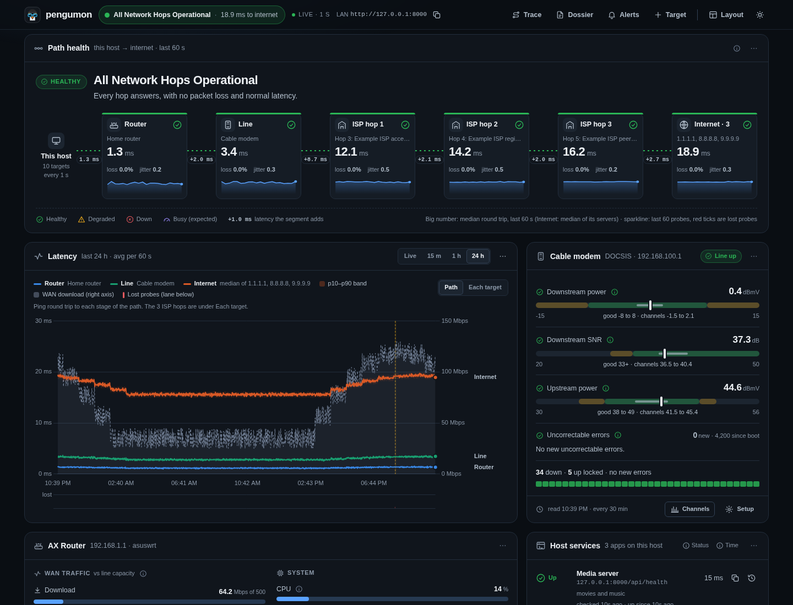
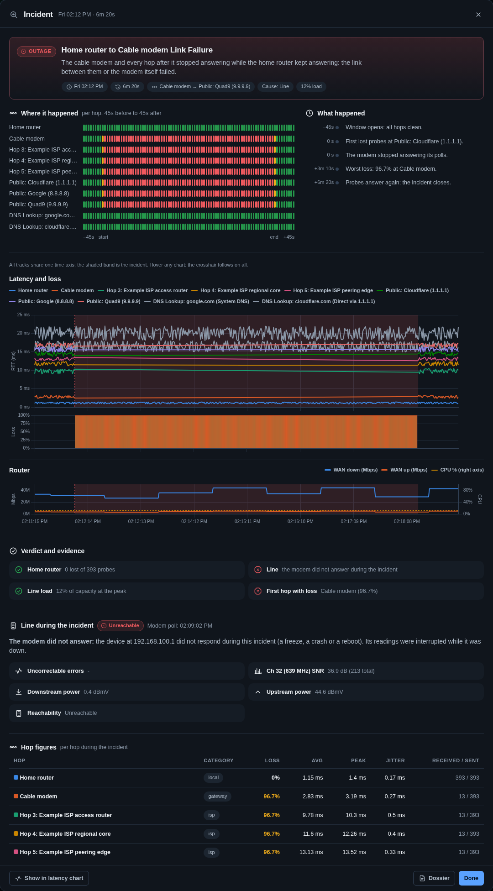
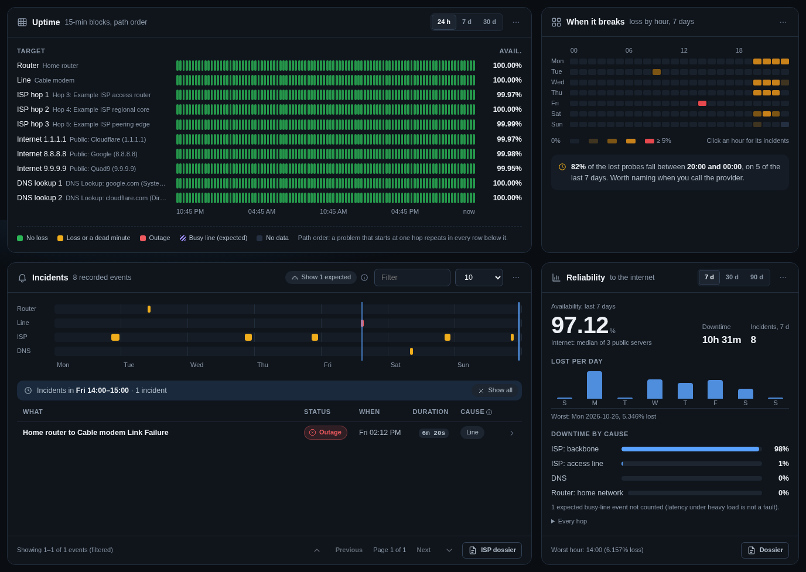
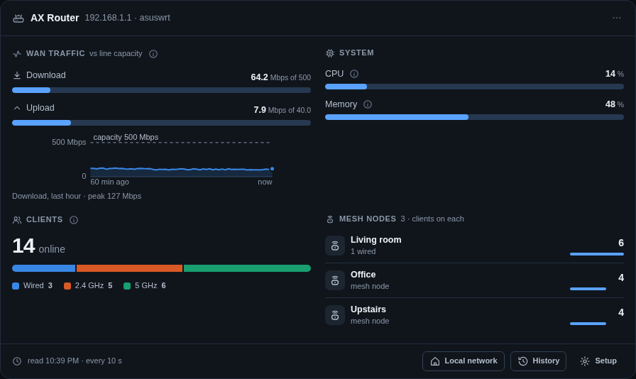
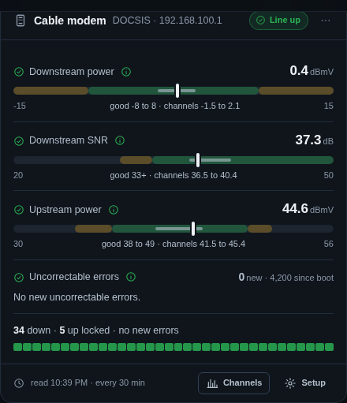
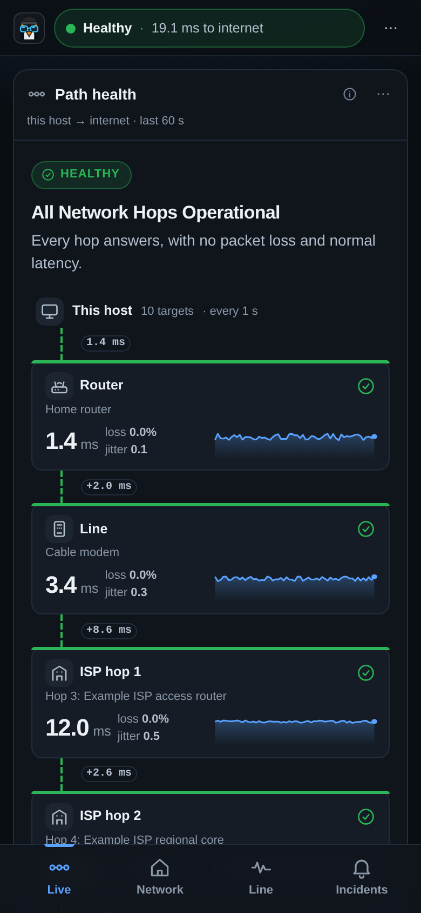
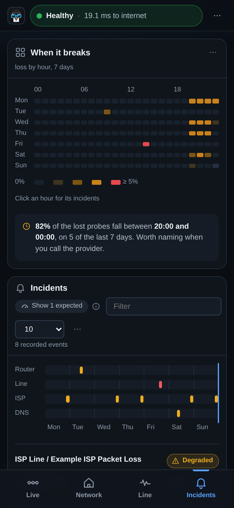
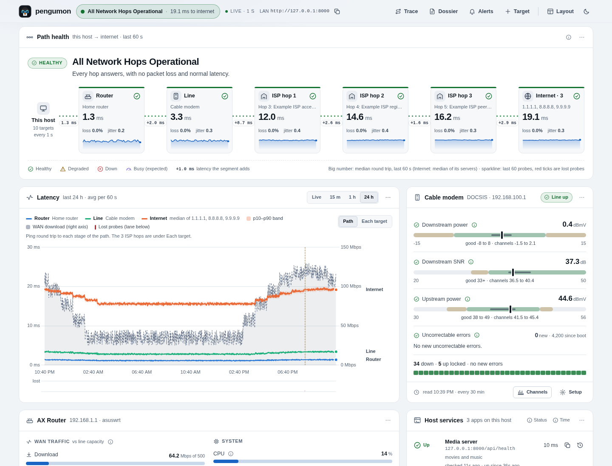

<p align="center">
  
</p>

<h1 align="center">Pengumon</h1>

<p align="center">
  <a href="https://github.com/pengupowered/pengumon/actions/workflows/ci.yml"></a>
  <a href="LICENSE"></a>
</p>

<p align="center">
  <b>Find out where your internet actually breaks: your Wi-Fi, your modem, your provider, or the internet beyond.</b><br>
  A self-hosted network monitor that pings every hop once a second, explains each outage, and keeps the evidence.
</p>

<p align="center">
  
</p>

## Why

"The internet is slow again" is hard to act on. Was it the Wi-Fi, the cable to the modem, a congested node at the
provider, or one far-away server? Pengumon watches each stage of the path all the time, so when something goes wrong
you can see where it started, how long it lasted and what the modem and router were doing at that moment, and hand your
provider a report instead of a hunch.

## Features

- **The whole path, live.** This host → router → modem → each provider hop → the internet, with the median latency,
  loss and jitter of every stage and how much each link adds.
- **Every outage explained.** A classifier places each problem in your home network, the line, the provider or beyond,
  and records an incident with per-hop evidence, the modem's signal and the line load at the time.
- **Busy is not broken.** Router WAN traffic is taken into account, so lag while someone is downloading is marked as
  expected rather than reported as a fault.
- **Patterns over time.** Loss by hour of the week, per-target uptime, a reliability report, and an ISP dossier to send
  to support. Click any hour or uptime block to see the incidents in it.
- **Your modem and router.** DOCSIS channel levels and codeword errors; router CPU, memory, WAN traffic, connected
  clients and mesh nodes. Drivers are pluggable.
- **Your own apps too.** HTTP health checks for self-hosted services, with incidents and alerts by [ntfy](https://ntfy.sh) or webhook.
- **Small and private.** One container and one SQLite file. Nothing leaves your network unless you turn on
  notifications or the optional OpenTelemetry export. Works on a phone.

## Install

Pengumon runs on a Linux host with Docker or Podman (x86-64, or arm64 such as a Raspberry Pi). It uses host
networking so the probes measure the host's own path. The image is published, so nothing is built:

```bash
mkdir pengumon && cd pengumon
curl -fsSL https://raw.githubusercontent.com/pengupowered/pengumon/main/compose.release.yaml -o compose.yaml
curl -fsSL https://raw.githubusercontent.com/pengupowered/pengumon/main/config.example.yaml -o config.yaml
# edit config.yaml: your router, modem and provider hops (see below)
docker compose up -d                  # or: podman compose up -d
```

Then open `http://<host>:8000`. Optional settings (access token, device passwords, ntfy) go in a `.env` file next to
`compose.yaml`; [`.env.example`](.env.example) lists them. To upgrade, change the version in the `image:` line to the
newest [release](https://github.com/pengupowered/pengumon/releases) and run `docker compose up -d` again; the data
lives in the `pengumon_data` volume.

**Build from source instead:**

```bash
git clone https://github.com/pengupowered/pengumon.git
cd pengumon
cp config.example.yaml config.yaml    # your router, modem and provider hops (see below)
cp .env.example .env                  # optional: access token, device passwords, ntfy
docker compose up -d --build          # or: podman-compose up -d --build
```

> [!TIP]
> Not sure which hops your traffic takes? Open **Trace** in the header, trace to `1.1.1.1`, and press **Monitor**
> on each hop, choosing whether it is your router, your line or a provider hop.

> [!IMPORTANT]
> Anyone who can reach port 8000 can read the data and change settings until you set `PENGUMON_ACCESS_TOKEN` in
> `.env`. See [docs/security.md](docs/security.md).

The container runs as an unprivileged user with a read-only root filesystem: it writes only to the `pengumon_data`
volume (`/app/data`) and a `/tmp` tmpfs, both set up in the compose files. The image is built from the same wheel
that `pip install` uses, and carries no source tree.

Rootless Podman needs unprivileged ping allowed for your user:
`net.ipv4.ping_group_range = 0 2147483647` (for example in `/etc/sysctl.d/60-unprivileged-ping.conf`).

**Docker Desktop (macOS, Windows):** not tested. Its containers run inside a virtual machine, so host networking
attaches to that VM and not to your computer, and the probes would measure the VM's path (and whether unprivileged
ICMP works there is unknown). Run Pengumon on a Linux machine that stays on, such as a Raspberry Pi or a small PC, and
open its page from your Mac or PC.

## Telling it about your network

Each target has a **category** that places it on the path. Any number of each works, and none is required:

| Category  | Shown as      | Typically                                       |
|-----------|---------------|-------------------------------------------------|
| `local`   | Router        | your router or mesh nodes                       |
| `gateway` | Line          | the cable/fiber modem or the provider's box     |
| `isp`     | ISP hop 1, 2… | your provider's routers, in path order          |
| `public`  | Internet      | public resolvers; the figure is their median    |
| `custom`  | its own name  | anything else worth watching: a NAS, a VPN, a server |

```yaml
targets:
  - { id: router, name: "Home router",  category: local,   address: "192.168.1.1" }
  - { id: modem,  name: "Cable modem",  category: gateway, address: "192.168.100.1" }
  - { id: isp1,   name: "First ISP hop", category: isp,    address: "198.51.100.1" }
  - { id: cf,     name: "Cloudflare",   category: public,  address: "1.1.1.1" }
  - { id: google, name: "Google",       category: public,  address: "8.8.8.8" }

devices:                                # optional: read the modem and router too
  - { id: modem,  driver: xfinity_xb, url: "http://192.168.100.1" }
  - { id: router, driver: asuswrt,    url: "http://192.168.1.1" }
```

The dashboard adapts to the shape of your network. A long path folds its provider hops into one node when space runs
out. A provider router that ignores ping while traffic passes through it is shown as such, not as down. Custom targets
are listed under the path. Everything is in [docs/configuration.md](docs/configuration.md).

### Supported devices

| Driver       | Devices                                  | What it reads                                              |
|--------------|------------------------------------------|------------------------------------------------------------|
| `xfinity_xb` | Xfinity / Comcast XB6, XB7, XB8 gateways | DOCSIS downstream and upstream levels, SNR, codeword errors |
| `asuswrt`    | AsusWRT routers (RT-AX, ZenWiFi, …)      | WAN traffic, CPU, memory, clients by band, mesh nodes      |
| `openwrt`    | OpenWrt routers (with LuCI, or rpcd and uhttpd-mod-ubus) | WAN traffic, CPU, memory, model, clients (DHCP leases, Wi-Fi stations by band) |
| `snmp`       | Anything with an SNMPv2c agent: routers, switches, NAS boxes | WAN (or uplink) traffic, CPU, memory, model |

Probing works with any equipment; devices are an optional extra. Setting up each one, and adding a driver, is
described in [docs/devices.md](docs/devices.md).

## Alerts

Pengumon can tell you when an incident starts and ends, and when one of your own apps stops answering. Expected
conditions (busy line) never alert, a cause alerts at most once every 5 minutes, and a slow receiver cannot delay the
probes. Two channels, either or both:

- **ntfy.** Set `PENGUMON_NOTIFY_URL` (and `PENGUMON_NOTIFY_TOKEN` for a protected server) in `.env`.
- **Webhooks.** List them under `notifications.webhooks` in `config.yaml`: Discord, Slack, or JSON for Home Assistant
  and your own scripts. Tokens go in headers, which may name a secret instead of holding it.

```yaml
notifications:
  public_url: "http://pengu.lan:8000"   # optional: the dashboard link in the messages
  webhooks:
    - { name: discord, url: "https://discord.com/api/webhooks/<id>/<token>", format: discord }
```

The **Alerts** dialog lists the configured channels and has a **Send test** button. The payload, the three formats and
the Home Assistant recipe are in [docs/webhooks.md](docs/webhooks.md).

## A closer look

<table>
  <tr>
    <td width="50%"></td>
    <td width="50%"></td>
  </tr>
  <tr>
    <td><b>Incident inspector.</b> Where loss first appeared, every hop before, during and after, the modem's signal and the line load.</td>
    <td><b>When it breaks.</b> Loss by hour of the week; click an hour to see its incidents.</td>
  </tr>
  <tr>
    <td></td>
    <td></td>
  </tr>
  <tr>
    <td><b>Router.</b> WAN traffic against the line's capacity, CPU and memory, clients by band and per mesh node.</td>
    <td><b>Cable modem.</b> Signal levels against their good ranges, codeword errors and channel lock, with history.</td>
  </tr>
</table>

<p align="center">
  
  &nbsp;&nbsp;
  
  &nbsp;&nbsp;
  
</p>

## Documentation

| Page | What is in it |
|---|---|
| [Configuration](docs/configuration.md) | Targets, DNS lookups, thresholds, retention, line capacity, the classifier |
| [Devices](docs/devices.md) | The `devices:` list: drivers, capabilities, TLS, credentials, writing a driver |
| [Diagnosis](docs/diagnosis.md) | How outages are classified: load-aware rules, incident kinds and causes |
| [Dashboard](docs/dashboard.md) | The panels, the path chain, layout, themes, the phone view |
| [Clients](docs/clients.md) | Connected clients and mesh nodes, privacy settings, what is stored |
| [Services](docs/services.md) | Health checks for your own apps and their notifications |
| [Webhooks](docs/webhooks.md) | Alerts to Discord, Slack, Home Assistant or any URL: config, payload, secrets |
| [Telemetry](docs/telemetry.md) | What is stored and sent, logging, OpenTelemetry, ntfy |
| [Security](docs/security.md) | Access token, request guard, environment variables |
| [Storage](docs/storage.md) | Database layout, migrations, upgrade notes |
| [API](docs/api.md) | Data and operations endpoints |
| [Architecture](docs/architecture.md) | Components, start-up order, the live message |
| [Testing](docs/testing.md) | Unit tests, browser tests and lint |
| [Supply chain](docs/supply-chain.md) | Dependency policy, hash-locked requirements, vendored code |

## Development

```bash
pip install -e ".[dev]"
PENGUMON_CONFIG=config.yaml PENGUMON_DATA=data python -m pengumon.main   # :8000 on 127.0.0.1, ./config.yaml
pytest                             # unit tests
scripts/test.sh                    # the same, in a container
tests/ui/runner/build.sh           # once: the browser test image
scripts/test-ui.sh                 # browser tests in headless Chromium, no network
```

Dependencies are hash-locked (`requirements*.txt`, generated from the `.in` files) and installed with
`--require-hashes`. `scripts/deploy.sh` is the maintainer's deploy: it adds a dependency audit (the separate `depguard`
tool, run when it is installed), a rollback image and a database backup before rebuilding. `docker compose` is all you need to run Pengumon. Releases are cut as described in [docs/releasing.md](docs/releasing.md).

## How accurate is it?

ICMP probes use kernel receive timestamps (`SO_TIMESTAMPNS`, as `ping` does) over one shared raw socket, started
25 ms apart. Against a continuous `ping` they agree within about 0.2 ms. DNS timings are measured in Python and can
read a few tenths of a millisecond high.

## License

[MIT](LICENSE). Chart.js, bundled in `src/pengumon/web/static/vendor/`, is also MIT-licensed.
